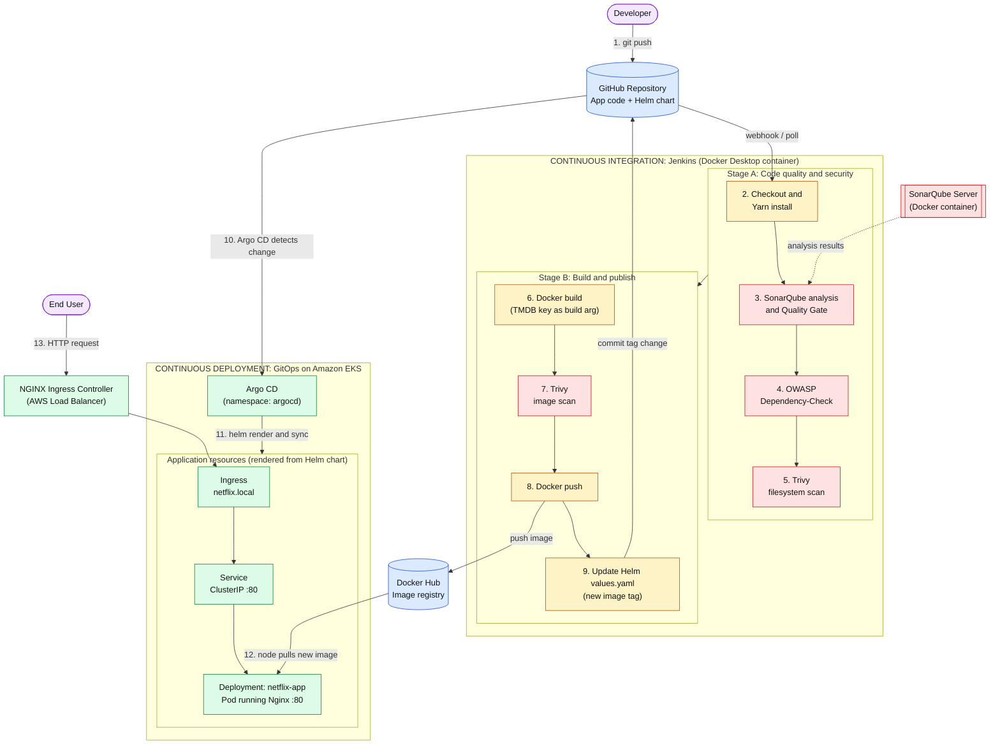

# Netflix Clone: DevSecOps CI/CD Project

A Netflix clone (React + Vite, using the TMDB API) deployed through a complete **DevSecOps pipeline**: Jenkins for CI, security scanning at multiple stages, Docker Hub for images, Helm for packaging, and **Argo CD (GitOps)** for continuous deployment to **Amazon EKS**.

**Repository:** https://github.com/vardhan-na/Netflix-clone.git

---

## Table of Contents

1. [Pipeline Overview](#pipeline-overview)
2. [Tools Used](#tools-used)
3. [Push Code to GitHub](#1-push-code-to-github)
4. [Dockerfile](#2-dockerfile)
5. [Kubernetes Manifests](#3-kubernetes-manifests)
6. [Helm Chart](#4-helm-chart)
7. [Jenkins Pipeline](#5-jenkins-pipeline)
8. [Helm Installation](#6-helm-installation)
9. [Kubernetes (EKS) Setup](#7-kubernetes-eks-setup)
10. [NGINX Ingress Controller](#8-nginx-ingress-controller)
11. [Jenkins and SonarQube in Docker Desktop](#9-jenkins-and-sonarqube-in-docker-desktop)
12. [Install Trivy in the Jenkins Container](#10-install-trivy-in-the-jenkins-container)
13. [Argo CD Setup](#11-argo-cd-setup)
14. [How Jenkins and Argo CD Work Together](#how-jenkins-and-argo-cd-work-together)
15. [Final Takeaway](#final-takeaway)

---

## Pipeline Overview

```
GitHub Checkout
      ↓
Install Dependencies (Yarn)
      ↓
SonarQube Analysis
      ↓
Quality Gate
      ↓
OWASP Dependency Check
      ↓
Trivy Filesystem Scan
      ↓
Docker Build
      ↓
Trivy Docker Image Scan
      ↓
Docker Push (Docker Hub)
      ↓
Update Helm values.yaml (GitHub)
      ↓
Argo CD Synchronization
      ↓
Kubernetes Deployment
      ↓
Netflix Clone Application Running
```

### Architecture Diagram



**Colour legend:** blue = source and registry, orange = CI build steps, red = security and quality checks, green = Kubernetes / GitOps deployment, purple = people.

**Numbered flow (matches the numbers in the diagram)**

| Step | What happens |
| --- | --- |
| 1 | Developer pushes code to GitHub |
| 2 | Jenkins checks out the code and installs dependencies with Yarn |
| 3 | SonarQube analyses the code; the Quality Gate must pass |
| 4 | OWASP Dependency-Check scans third-party libraries |
| 5 | Trivy scans the project files |
| 6 | Docker image is built (TMDB API key passed as a build argument) |
| 7 | Trivy scans the built Docker image |
| 8 | Image is pushed to Docker Hub |
| 9 | Jenkins updates the image tag in Helm `values.yaml` and commits it to GitHub |
| 10 | Argo CD detects the change in the GitHub repo |
| 11 | Argo CD renders the Helm chart and syncs it to the EKS cluster |
| 12 | Kubernetes pulls the new image from Docker Hub and updates the Pods |
| 13 | Users reach the app through the NGINX Ingress Controller → Ingress → Service → Pod |


---

## Tools Used

| Tool | Responsibility |
| --- | --- |
| Jenkins | Automates the CI/CD pipeline |
| GitHub | Stores application source code and Helm configuration |
| Yarn | Installs application dependencies |
| SonarQube | Static code quality and security analysis |
| OWASP Dependency-Check | Identifies vulnerable third-party dependencies |
| Trivy | Scans project files and Docker images for vulnerabilities |
| Docker | Builds and packages the application into container images |
| Docker Hub | Stores versioned Docker images |
| Helm | Manages Kubernetes application templates and configuration |
| Argo CD | GitOps-based continuous deployment |
| Kubernetes (Amazon EKS) | Runs and manages application containers |

---

## 1. Push Code to GitHub

```bash
git init
git add .
git commit -m "Initial commit"
git branch -M main
git remote add origin https://github.com/vardhan-na/Netflix-clone.git
git push -u origin main
```

---

## 2. Dockerfile

A multi-stage Dockerfile for the React/Vite app. Stage 1 builds the app; stage 2 serves the built files with Nginx.

```dockerfile
# Stage 1: Build
FROM node:16.17.0-alpine AS builder
WORKDIR /app
COPY ./package.json .
COPY ./yarn.lock .
RUN yarn install --frozen-lockfile
COPY . .
ARG TMDB_V3_API_KEY
ENV VITE_APP_TMDB_V3_API_KEY=${TMDB_V3_API_KEY}
ENV VITE_APP_API_ENDPOINT_URL="https://api.themoviedb.org/3"
RUN yarn build

# Stage 2: Serve
FROM nginx:stable-alpine
RUN apk update && apk upgrade --no-cache
WORKDIR /usr/share/nginx/html
RUN rm -rf ./*
COPY --from=builder /app/dist .
EXPOSE 80
ENTRYPOINT ["nginx", "-g", "daemon off;"]
```

**What each part does**

| Instruction | Purpose |
| --- | --- |
| `FROM node:16.17.0-alpine AS builder` | Small Alpine image with Node 16.17.0; named `builder` so stage 2 can copy from it |
| `WORKDIR /app` | Sets the working directory inside the container |
| `COPY package.json / yarn.lock` + `yarn install --frozen-lockfile` | Installs the exact locked dependency versions. Copying these first lets Docker cache the install layer |
| `COPY . .` | Copies the rest of the source code |
| `ARG TMDB_V3_API_KEY` | Build-time argument for the TMDB API key |
| `ENV VITE_APP_...` | Variables Vite reads (must start with `VITE_`): API key and API base URL |
| `RUN yarn build` | Compiles static HTML/JS/CSS into `/app/dist` |
| `FROM nginx:stable-alpine` | Fresh, small Nginx image; Node and source are not carried over |
| `RUN apk update && apk upgrade --no-cache` | Patches OS packages to fix vulnerabilities flagged by Trivy (libexpat, pcre2) |
| `RUN rm -rf ./*` + `COPY --from=builder` | Removes the default Nginx page and copies in the built app |
| `EXPOSE 80` | Documents that the container listens on port 80 |
| `ENTRYPOINT [...]` | Runs Nginx in the foreground so the container stays alive |

**Build and run locally**

```bash
docker build --build-arg TMDB_V3_API_KEY=<your_tmdb_api_key> -t netflix-clone .
docker run -d -p 8080:80 netflix-clone
```

The app is then available at `http://localhost:8080`.

> **Never commit your TMDB API key.** Pass it at build time (Jenkins injects it from the `tmdb-api-key` credential).

---

## 3. Kubernetes Manifests

| Resource | Purpose |
| --- | --- |
| Deployment | Creates and manages the application Pods |
| Service | Stable internal network access to the Pods |
| Ingress | Exposes the application externally via an HTTP hostname |

### Deployment (`deployment.yaml`)

```yaml
apiVersion: apps/v1
kind: Deployment
metadata:
  name: netflix-app
  labels:
    app: netflix-app
spec:
  replicas: 1
  selector:
    matchLabels:
      app: netflix-app
  template:
    metadata:
      labels:
        app: netflix-app
    spec:
      containers:
      - name: netflix-app
        image: vardhan2912/netflix-clone:{{ .Values.image.tag }}
        ports:
        - containerPort: 80
```

- `replicas: 1`: Kubernetes keeps one Pod running.
- `selector.matchLabels` and the Pod `labels` must match so the Deployment can find its Pods.
- `image`: pulled from Docker Hub; `{{ .Values.image.tag }}` is a Helm expression filled from `values.yaml`.
- `containerPort: 80`: the container listens on port 80.

### Service (`service.yaml`)

```yaml
apiVersion: v1
kind: Service
metadata:
  name: netflix-app
  labels:
    app: netflix-app
spec:
  ports:
  - port: 80
    targetPort: 80
    protocol: TCP
  selector:
    app: netflix-app
  type: ClusterIP
```

- `port: 80`: port on which the Service is reachable inside the cluster.
- `targetPort: 80`: forwards traffic to port 80 of the container.
- `selector`: sends traffic to Pods labelled `app: netflix-app`.
- `type: ClusterIP`: internal-only cluster IP.

### Ingress (`ingress.yaml`)

```yaml
apiVersion: networking.k8s.io/v1
kind: Ingress
metadata:
  name: netflix-ingress
spec:
  ingressClassName: nginx
  rules:
    - host: netflix.local
      http:
        paths:
          - path: /
            pathType: Prefix
            backend:
              service:
                name: netflix-app
                port:
                  number: 80
```

- `ingressClassName: nginx`: handled by the NGINX Ingress Controller.
- `host: netflix.local`: hostname used to reach the app.
- `path: /` with `pathType: Prefix`: matches the root URL and all subpaths.
- `backend`: routes traffic to the `netflix-app` Service on port 80.

---

## 4. Helm Chart

- Added the Deployment, Service and Ingress YAML files to the chart's `templates/` folder.
- Wrote `values.yaml`, which stores the configurable values Helm uses to render the manifests.

### `values.yaml`

```yaml
replicaCount: 1

image:
  repository: vardhan2912/netflix-clone
  pullPolicy: IfNotPresent
  # Overrides the image tag whose default is the chart appVersion.
  tag: "34"
```

| Key | Purpose |
| --- | --- |
| `replicaCount: 1` | Number of application Pods |
| `image.repository` | Docker Hub repository holding the image |
| `image.pullPolicy: IfNotPresent` | Pull the image only if it is not already on the node |
| `image.tag: "34"` | Image version to deploy (updated automatically by Jenkins on each build) |

---

## 5. Jenkins Pipeline

The CI/CD pipeline is written as a Jenkins **Declarative Pipeline**. It automates everything from checking out the source code to security scanning, building and publishing the Docker image, and deploying to Kubernetes through Argo CD.

### Required Jenkins credentials

Configure under **Manage Jenkins → Credentials**:

| Credential ID | Type | Purpose |
| --- | --- | --- |
| `dockerhub-creds` | Username with password | Docker Hub login and image publishing |
| `sonar-token` | Secret text | SonarQube Quality Gate authentication |
| `nvd-api-key` | Secret text | NVD vulnerability database access |
| `tmdb-api-key` | Secret text | TMDB API key for the application build |
| `github-creds` | Username with password | GitHub authentication for GitOps updates |

> **Note:** Install the required Jenkins plugins before running the pipeline (list of plugins: _TBD_, e.g. Pipeline, Docker Pipeline, SonarQube Scanner, OWASP Dependency-Check, Credentials Binding, Git).

---

## 6. Helm Installation

Install Helm locally (run in PowerShell):

```powershell
winget install Helm.Helm
```

Verify the installation:

```powershell
helm version
```

---

## 7. Kubernetes (EKS) Setup

### Prerequisites

- **kubectl**: command line tool for working with Kubernetes clusters.
- **eksctl**: command line tool that automates many EKS tasks.
- **AWS CLI**: command line tool for AWS services. After installing, configure it with `aws configure`.

Complete the prerequisites before creating the cluster.

### Create the EKS cluster

```bash
eksctl create cluster --name <cluster_name> --region <region_name>
```

### Delete the cluster (to avoid AWS charges)

```bash
eksctl delete cluster --name <cluster_name> --region <region_name>
```

---

## 8. NGINX Ingress Controller

Install the NGINX Ingress Controller on AWS by deploying this manifest:

```bash
kubectl apply -f https://raw.githubusercontent.com/kubernetes/ingress-nginx/controller-v1.11.1/deploy/static/provider/aws/deploy.yaml
```

---

## 9. Jenkins and SonarQube in Docker Desktop

Used Docker Desktop to pull the latest Jenkins and SonarQube images and ran both as containers.

Exact `docker run` commands / ports used: _TBD_

---

## 10. Install Trivy in the Jenkins Container

Run these commands in PowerShell.

Find the Jenkins container:

```powershell
docker ps
```

Update packages and install required tools:

```powershell
docker exec -u root jenkins bash -c "apt-get update && apt-get install -y wget gnupg"
```

Download and install the Trivy repository GPG key:

```powershell
docker exec -u root jenkins bash -c "wget -qO - https://aquasecurity.github.io/trivy-repo/deb/public.key | gpg --dearmor -o /usr/share/keyrings/trivy.gpg"
```

Add the Trivy APT repository:

```powershell
docker exec -u root jenkins bash -c "echo 'deb [signed-by=/usr/share/keyrings/trivy.gpg] https://aquasecurity.github.io/trivy-repo/deb generic main' > /etc/apt/sources.list.d/trivy.list"
```

Install Trivy:

```powershell
docker exec -u root jenkins bash -c "apt-get update && apt-get install -y trivy"
```

Verify the installation:

```powershell
docker exec jenkins trivy --version
```

**Why install Trivy inside the Jenkins container instead of on Windows?**
The Jenkins pipeline runs its build and security-scanning commands inside the Jenkins environment. Installing Trivy there lets the pipeline run vulnerability scans directly, without depending on a separately installed Windows executable.

In short: Trivy is installed in Jenkins to automate Docker image security scanning as part of the CI/CD pipeline, identifying vulnerabilities before deployment to Kubernetes through Argo CD.

---

## 11. Argo CD Setup

Install Argo CD in the Kubernetes cluster:

```bash
kubectl create namespace argocd
kubectl apply -n argocd -f https://raw.githubusercontent.com/argoproj/argo-cd/stable/manifests/install.yaml
```

Expose the Argo CD UI with a LoadBalancer service (Linux/macOS/Git Bash):

```bash
kubectl patch svc argocd-server -n argocd -p '{"spec": {"type": "LoadBalancer"}}'
```

On Windows (PowerShell), escape the quotes:

```powershell
kubectl patch svc argocd-server -n argocd -p '{\"spec\": {\"type\": \"LoadBalancer\"}}'
```

Get the LoadBalancer address:

```bash
kubectl get svc argocd-server -n argocd
```

Argo CD application configuration (repo URL, path, sync policy): _TBD_

---

## How Jenkins and Argo CD Work Together

| Jenkins (CI) | Argo CD (CD / GitOps) |
| --- | --- |
| Fetches application source code | Monitors the GitHub repository |
| Installs dependencies | Detects Helm configuration changes |
| Performs SonarQube analysis | Reads the updated Helm chart |
| Runs OWASP Dependency-Check | Synchronizes the desired configuration |
| Performs Trivy scans | Applies changes to Kubernetes |
| Builds the Docker image | Manages deployment synchronization |
| Pushes the image to Docker Hub | Kubernetes pulls the new image |
| Updates Helm `values.yaml` | Application Pods are updated |

---

## Final Takeaway

This project follows a DevSecOps approach: security scanning is built into every stage of the CI/CD pipeline, only images that pass the configured security checks are published, and GitOps with Argo CD automates application deployment and updates on Kubernetes.

---

## Author

**K A Vardhan**: [github.com/vardhan-na](https://github.com/vardhan-na)
